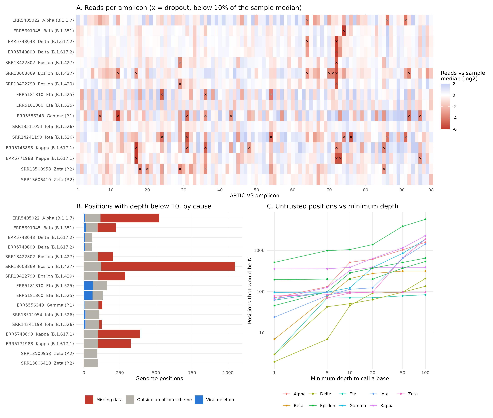
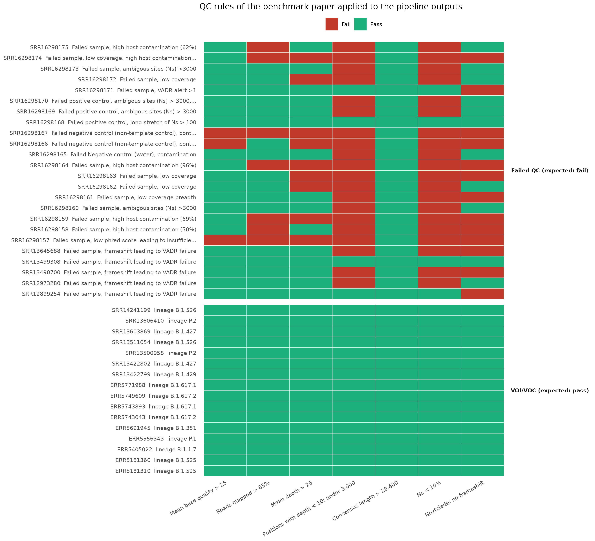

# How Much of a Sequenced Viral Genome Can Be Trusted?

**A reproducible SARS-CoV-2 amplicon pipeline (Bash and Nextflow), validated on a public benchmark, with an analysis of which genome regions can be trusted and why.**

**Status: work in progress.** The pipeline, its validation and the analyses below are complete and reproducible. A comparison with nf-core/viralrecon and the items in [Next steps](#next-steps) are not done yet.

## Summary

Viral genomes from amplicon sequencing are routinely used for surveillance, but parts of each genome cannot be read, and some samples should not be trusted at all. Using a published CDC benchmark with known answers, I built a SARS-CoV-2 pipeline, validated it, and asked which parts of the genomes can be trusted.

**Main findings:**
- **Validation:** the pipeline reproduced the expected lineage for **16 of 16** benchmark samples (10 Pango lineages). The Nextflow version reproduces the Bash version's consensus genomes **byte for byte**.
- **Not all low-depth regions are missing data.** Short low-depth regions shared by several lineages are **real viral deletions**, correctly reported by Nextclade. The rest is true missing data, mostly from **amplicon dropout**.
- **A recurring dropout explained by the virus itself.** Amplicon 72 of the ARTIC V3 primer scheme failed in **all 7** samples whose lineage carries a change inside its right primer (Epsilon, Kappa, Delta), and in **none of the 9** others. In shallow samples this left part of the spike gene unreadable.
- **QC validation:** applying the benchmark paper's QC rules, the pipeline passed **16 of 16** good samples and caught **22 of 24** known failures. The two misses show what depth-based QC cannot see.

## Data

**Source:** CDC SARS-CoV-2 benchmark datasets (Xiaoli et al. 2022, *PeerJ* 10:e13821; [CDCgov/datasets-sars-cov-2](https://github.com/CDCgov/datasets-sars-cov-2)). Reads from NCBI SRA and ENA. Reference genome MN908947.3 (Wuhan-Hu-1).

| Dataset | Samples | Primers | Purpose |
|---|---|---|---|
| VOI/VOC lineages | 16 (Illumina paired-end) | ARTIC V3 | Known lineages: validate the pipeline |
| Failed QC | 24 (Illumina paired-end) | 19 CDC in-house, 5 ARTIC V3 | Known failures (contamination, low coverage, Ns, frameshifts, failed controls): validate the QC |

### Data problems found and handled

| Problem | Evidence | Handling |
|---|---|---|
| Paired files out of step | All **9 ENA-deposited** samples had different read counts in their two files (0.1 to 0.5% of reads without a mate); all 7 SRA samples were consistent. The aligner refused them. | Reads re-paired by name with `seqkit pair` before alignment |
| Pre-filtered uploads | 8 of the 9 ENA samples map 100% to the virus, which real sequencing data rarely does | Noted; consistent with reads filtered per file before deposit |
| Different primer schemes | 19 failed-QC samples used CDC in-house primers, not ARTIC V3 | Primer trimming skipped for them (trimming ARTIC positions would corrupt the reads); the QC rules used do not depend on it |
| Versioned ground truth | Expected lineages were assigned in 2021 (pangolin v3.1.3); lineage names have been refined since | Compared with care; all 16 matched anyway |

## Pipeline

| Step | Tool | Key settings |
|---|---|---|
| Read QC | fastp | adapters and low-quality ends removed, reads < 50 bases dropped |
| Alignment | BWA-MEM, samtools | sorted, indexed BAM; mapping statistics with `samtools flagstat` |
| Primer trimming | iVar trim | ARTIC V3 primer BED; base quality ≥ 20; reads < 30 bases dropped |
| Depth | samtools depth | every genome position, including zero depth |
| Consensus | samtools mpileup, iVar consensus | base called if ≥ 10 reads and ≥ 75% agree, otherwise **N** |
| Lineage and QC | Nextclade | Pango lineage, clade, frameshift and other QC checks |

**Two implementations:**
- `scripts/02_pipeline.sh`: Bash, one sample after another. Written first, by running each step by hand.
- `main.nf`: Nextflow, same commands. Runs samples in parallel (82 tasks in about 7.5 minutes, 0.9 CPU hours, i.e. about 7 CPUs used at once), resumes after failures (`-resume`), takes the sample sheet and output folder as parameters, and has a SLURM profile for HPC clusters (**not tested on a real cluster**). Its 16 consensus genomes are identical to the Bash version's.

Analyses and figures are in **R** (tidyverse, ggplot2).

## Results

### 1. Lineage validation: 16 of 16

Every sample received its expected Pango lineage: B.1.1.7 (Alpha), B.1.351 (Beta), P.1 (Gamma), B.1.617.2 (Delta), B.1.427 and B.1.429 (Epsilon), B.1.525 (Eta), B.1.526 (Iota), B.1.617.1 (Kappa), P.2 (Zeta). This includes the shallowest sample (mean depth 320, 1,046 Ns): missing 3.5% of the genome did not hide its lineage-defining mutations.

Genome completeness (depth ≥ 10) ranged from **96.5% to 99.8%**, with 46 to 1,046 Ns per genome, closely following sequencing depth.

### 2. Why positions cannot be read



*A: reads per amplicon, relative to each sample's median; crosses mark dropouts (below 10% of the median). B: positions with depth below 10, by cause. C: positions that would become N at different minimum depths.*

**Two kinds of low-depth regions.** Short regions shared by several lineages match deletions reported by Nextclade, for example 11,288 to 11,296 (Alpha, Beta, Gamma, Eta, Iota), 21,765 to 21,770 (Alpha, Eta) and 22,029 to 22,034 (Delta). There the virus has no bases: the depth drop is biology, and the consensus correctly contains a deletion. Everything else is **missing data**, mostly amplicon dropout and low sequencing depth.

**The depth threshold matters most for shallow samples.** For deep samples (Delta, Zeta) the number of untrusted positions barely changes between minimum depth 1 and 100; for shallow samples it rises steeply above depth 20.

### 3. A dropout caused by the virus's own mutations

| Lineage | Samples | Change inside the amplicon 72 right primer (22,014 to 22,038) | Amplicon 72 |
|---|---|---|---|
| Epsilon | 3 | G22018T (spike W152C) | dropout in all 3 |
| Kappa | 2 | G22022A (spike E154K) | dropout in both |
| Delta | 2 | deletion 22,029 to 22,034 (spike 156 to 157) | dropout in both |
| 6 other lineages | 9 | none | no dropout |

A mismatch in a primer's binding site weakens it; the Epsilon mutation sits only 5 bases from the primer's 3' end, where mismatches matter most. After primer trimming, positions 21,892 to 21,990 are covered by amplicon 72 alone, so in the shallow Epsilon samples this spike region became N. It includes spike codon 142, consistent with a reported underrepresentation of Delta's G142D mutation in ARTIC V3 data (Davis et al., bioRxiv 2021, doi:10.1101/2021.09.27.461949). In the two Delta samples here, sequencing depth was high enough that the weak amplicon still gave readable bases: **whether a weak amplicon becomes missing data depends on depth.**

Both Kappa samples also lost amplicon 17; its cause was not investigated.

### 4. Does the QC catch bad samples?



The QC rules of the benchmark paper (Illumina), applied to both datasets: mean base quality > 25, reads mapped > 65%, mean depth > 25, fewer than 3,000 positions below depth 10, consensus length > 29,400, Ns < 10%, plus Nextclade's frameshift check (in place of the paper's VADR check).

| Dataset | Expected | Result |
|---|---|---|
| VOI/VOC | pass | **16 / 16 pass** |
| Failed QC | fail | **22 / 24 fail** |

- **Reads mapped > 65%** caught every host-contamination sample.
- **Depth and N rules** caught most low-coverage, dropout and N-rich samples.
- **Consensus length never fails** with this pipeline: iVar keeps the full genome length and writes N where it cannot call a base, so "Ns < 10%" does that job instead.
- **Only the frameshift check** caught the VADR-alert sample and one frameshift sample.

**The two misses:**
- **A positive control with a stretch of more than 100 consecutive Ns.** Its totals pass every rule; none of them measures one long gap. A rule such as "at most 100 Ns in a row" would catch it, but would also reject the three Epsilon samples, whose amplicon 72 gap is about 100 to 270 Ns long and which the authors counted as good. A real trade-off.
- **A frameshift sample** in which Nextclade finds no frameshift. The authors flagged a frameshift in the genome built by their own pipeline; it may be absent from this pipeline's consensus, or missed. Not resolved.

Nextclade flagged a frameshift in 3 of the 5 frameshift samples: **depth-based QC cannot see errors inside a well-covered genome.**

## Limitations

- **Small numbers per lineage** (1 to 3 samples). The amplicon 72 pattern is consistent across 16 samples, but it is a well-supported mechanism, not a proof.
- **One primer scheme, one platform.** ARTIC V3 and Illumina only; ARTIC V4 and Nanopore data were not tested.
- **No primer trimming for the 19 CDC in-house samples**: their consensus genomes may contain primer bases.
- **Frameshifts checked with Nextclade, not VADR**, so the QC comparison with the paper is not exact for those samples.
- **The SLURM profile is untested** on a real cluster, and the pipeline uses conda environments, not containers.

## Next steps

- [ ] Compare with **nf-core/viralrecon** on the same samples
- [ ] Inspect the frameshift position of the missed sample (SRR13499308) in the reads
- [ ] Explain the Kappa amplicon 17 dropout
- [ ] Containers (Docker or Singularity) for the Nextflow pipeline, and a test on an HPC cluster
- [ ] Test on ARTIC V4 data, which redesigned the primers affected here

## Repository structure

```
├── main.nf                       Nextflow pipeline
├── nextflow.config               executors (local, SLURM), reports
├── envs/                         conda environments (pipeline tools, R)
├── data/
│   ├── samples.tsv               VOI/VOC samples and expected lineages
│   └── samples_failedqc.tsv      failed-QC samples, primer scheme, failure description
├── ref/                          reference genome, ARTIC V3 primer BED
├── scripts/
│   ├── 01_download.sh            reference, primers, VOI/VOC reads
│   ├── 01b_download_failedqc.sh  failed-QC reads (with pair check and re-pairing)
│   ├── 02_pipeline.sh            Bash version of the pipeline
│   ├── 03_trust_analysis.R       amplicon dropouts, missing data by cause, thresholds
│   └── 04_qc_check.R             benchmark QC rules on both datasets
├── results/                      consensus genomes, summaries, analysis tables
├── results_nf/, results_failedqc/  Nextflow run reports
└── figures/
```

## How to reproduce

```
conda env create -f envs/sarscov2.yml
conda env create -f envs/sarscov2-r.yml

conda activate sarscov2
bash scripts/01_download.sh
bash scripts/01b_download_failedqc.sh
bash scripts/02_pipeline.sh                      # Bash version
nextflow run main.nf                             # Nextflow version, VOI/VOC
nextflow run main.nf --samples data/samples_failedqc.tsv --outdir results_failedqc

conda activate sarscov2-r
Rscript scripts/03_trust_analysis.R
Rscript scripts/04_qc_check.R
```

The 9 ENA samples of the VOI/VOC set need re-pairing after download (`seqkit pair`, as in `01b_download_failedqc.sh`); this step is not yet automated in `01_download.sh`.


